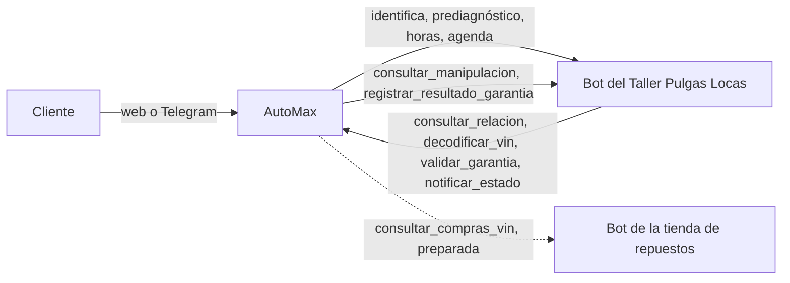

# AutoMax: resumen de todo lo hecho

Actualizado el 05/11/2026, en la rama `devCarlos`. El trabajo del 23/10 al 05/11 (secciones 3 a 9) se subió a esa rama
el 05/11/2026.

Más detalle en:
- [`DOCUMENTACION-TECNICA.md`](DOCUMENTACION-TECNICA.md): cómo está construido.
- [`DECISIONES.md`](DECISIONES.md): el porqué de cada decisión, numeradas.
- [`ESTADO.md`](ESTADO.md): los pendientes.
- [`DEMO.md`](DEMO.md): cómo mostrarlo.

---

## 1. Qué es AutoMax

AutoMax es un concesionario de carros con página web, API, base de datos y un asistente de IA que corre en el propio
equipo (Ollama con `gpt-oss:20b`). El asistente:

- atiende a los clientes por la web y por Telegram: stock, precios, financiación, test-drive y taller;
- se conecta con los bots de otras empresas: el **Taller Pulgas Locas**, y una **tienda de repuestos** que ya está preparada;
- valida garantías con reglas fijas, sin que decida el modelo.

**Stack:** NestJS + TypeORM + PostgreSQL 16 (pgvector) · React + Vite + Tailwind + shadcn/ui · Ollama · MCP
(`@modelcontextprotocol/sdk`) · A2A · Docker Compose · Vitest, Supertest y Playwright.

---

## 2. Las fases del proyecto

| Fase | Qué se construyó | Estado |
|---|---|---|
| 1. Base de datos | Docker con PostgreSQL 16 + pgvector, entidades, migraciones y seeds (10 marcas y 60 vehículos reales) | Cerrada (18/10/2026) |
| 2. APIs REST | Login JWT con roles, límites de peticiones, marcas y vehículos con filtros, clientes, citas sin solapes, ventas en transacción, simulador de crédito, Swagger | Cerrada (18/10/2026) |
| 3. Frontend | Portada, catálogo, detalle con simulador y test-drive, comparador de 3, panel admin (métricas, inventario, citas, clientes, ventas) | Cerrada (19/10/2026) |
| 4. Chatbot | Proveedores ollama/groq/mock, tools de catálogo y crédito, agendar con confirmación, búsqueda semántica, widget flotante, arnés de evaluación | **Abierta**: falta la evaluación de las 20 preguntas con el modelo real |
| 5. Servidor MCP | `POST /api/mcp` de solo lectura: `consultar_stock`, `consultar_precio`, `listar_marcas`; keys por bot y auditoría | Cerrada |
| 6. A2A | Tarjeta `agent.json`, tareas entrantes deterministas, cliente saliente con protección SSRF, tool `preguntar_a_otro_bot`, panel de bots | Hecha hasta la 6.7; **falta la 6.8** (revisión con Codex) |
| 7. Pulido | README final, guion de la demo, portada en móvil | En curso |

Después vino la integración con otras empresas, que es lo que se hizo en estas sesiones (secciones 3 a 9).

---

## 3. Mejoras del chat (23/10 a 05/11/2026)

- **Modelo `gpt-oss:20b`** en el Ollama de Docker, en lugar de `qwen2.5:7b` (decisión 124).
- **Saludos al instante, sin el modelo** (decisión 125). El saludo quedó corto, como se pidió: «¡Hola! Soy el asistente
  de AutoMax. ¿En qué te puedo colaborar?».
- **Fotos reales** de los 60 vehículos (Wikimedia Commons, WebP) y **filtro por color** en el catálogo y en el bot
  (decisiones 126 y 127).
- **Telegram** (decisión 128):
  - Es el mismo asistente de la web, con sesión por chat privado y long polling, sin URL pública.
  - Las citas usan la misma confirmación humana: botones «Agendar», «Confirmar» y `/cancelar`.
  - `/borrar` borra la conversación.
- **Lenguaje natural:**
  - El bot conversa normal y **solo pide el número de documento (DNI) y el VIN** cuando el cliente viene por una
    garantía, por el cambio de un repuesto o para llevar el carro al taller.
  - Si el cliente habla de garantía y no dice por qué, el bot le pide que **explique el motivo por el cual está
    cobrando la garantía**.
  - Ya no vuelve a preguntar los síntomas que el cliente contó.

---

## 4. El VIN (decisiones 129 y 132)

- **Registro de VIN** (tabla `vehiculos_vin`, migración 010): marca, modelo, año, versión, carrocería, motor,
  combustible y transmisión. **No guarda datos del dueño.**
- **`GET /api/vin/:vin`** y respuesta al instante en el chat cuando el mensaje trae un VIN.
- **Qué significa cada parte del VIN**, sin internet (ISO 3779):
  - país y región (posiciones 1 y 2);
  - fabricante (1 a 3);
  - modelo (4 a 8);
  - dígito verificador (9, cálculo de la FMVSS 115);
  - año (10);
  - planta (11);
  - serie (12 a 17).

  Probado con un VIN real de un Honda Accord 2003 (`1HGCM82633A004352`).
- **Ficha real de la NHTSA (EE. UU.)**, gratuita y sin clave, para los VIN que no están en nuestro registro. Solo se
  envía el VIN; tiene plazo, tope de tamaño y caché de un día. Se apaga con `VIN_DECODER_EXTERNAL=false`.
- **Verificar que los datos del cliente son verdaderos:** el documento y el VIN se comparan con la tabla `relaciones`.
  Si no coinciden, no se sigue, y tras 3 intentos fallidos se bloquea.

---

## 5. Relación cliente–vehículo (decisión 130)

- Tabla `relaciones` con el id `REL-####` que usa el taller (migración 011).
- La cédula, el nombre y el teléfono van **cifrados** (AES-256-GCM). Para buscar por cédula solo se guarda un **HMAC**.
- La garantía se calcula: 3 años desde la venta o 60.000 km, lo primero que ocurra; hay planes «todo» y «tren motriz».
- Semilla con los 8 casos de prueba del taller (REL-1001 a REL-1008).

---

## 6. El asistente agenda en el taller (decisiones 131 y 133)

El **modelo organiza los pasos** con tools y el servidor valida cada uno:

| Tool del modelo | Qué hace en el taller |
|---|---|
| `identificar_cliente_taller` | Verifica documento + VIN en nuestra base (la cédula **nunca** llega al modelo) |
| `prediagnosticar_taller` | `enrutar_garantia`: **el bot del taller decide la sede** y explica por qué |
| `listar_sedes_taller` | `listar_talleres` (PL-CENTRO, PL-FRENOS, PL-MOTOR) |
| `consultar_horarios_taller` | `consultar_disponibilidad` para 14 días; ofrece hasta 4 horas |
| `apartar_hora_taller` | `reservar_franja`: aparta la hora 10 minutos mientras el cliente confirma («la 2») |
| `agendar_cita_taller` | `agendar_cita` con `id_prediagnostico` e `id_reserva`, solo con un «sí» explícito |

Reglas que pone el servidor (no dependen del modelo):
- Los números de 6 a 10 dígitos se tapan como `[número]` antes del modelo y del historial.
- Solo se agenda una hora que el taller ofreció en esa conversación, y una sola orden por conversación.
- Un `id_mensaje` por acción, para que un reintento no duplique la orden.
- Se rechaza una respuesta que:
  - **invente horas** (una lista de horas sin haber consultado la agenda en ese turno);
  - diga «quedó agendada» sin haber agendado;
  - dé precios que no vienen del taller.
- Si el modelo no muestra el prediagnóstico, el servidor lo antepone.
- Lo que responde el taller se valida con zod y se sanea. Los datos personales que devuelve se descartan.

---

## 7. El taller consulta NUESTRO MCP (decisión 134)

- **Permiso `taller`** por bot (columna `bots_externos.permisos`, migración 012, casilla «Es el bot del taller» en el
  panel). Un bot sin ese permiso solo ve el catálogo.
- Cuatro herramientas nuevas, solo para el bot con ese permiso:
  - `consultar_relacion`: cliente, placa, VIN, kilometraje y garantía.
  - `decodificar_vin`: la ficha y qué significa el código.
  - `validar_garantia`: decide cada servicio con reglas fijas, responde el acuse y luego registra el resultado en el
    taller (`registrar_resultado_garantia`, con 3 intentos). Queda guardado en `validaciones_garantia`.
  - `notificar_estado_vehiculo`: actualiza nuestra copia de la orden en `ordenes_taller`.
- La auditoría guarda solo identificadores, nunca la cédula, el nombre, el teléfono ni el VIN.
- Para que el taller llegara desde la red local se configuró `MCP_ALLOWED_HOSTS` y se abrió el puerto 8000 en el
  firewall de Windows.

---

## 8. Garantía: el componente no puede estar manipulado (decisión 135)

`validar_garantia` aplica cinco reglas, en orden. La primera que falla deja el servicio **sin garantía**:

1. La garantía está vigente (por fecha y kilometraje).
2. El plan cubre ese componente. El mantenimiento general nunca lo cubre.
3. **El taller confirma que el componente no fue manipulado** (`consultar_manipulacion`): reparaciones, cambios de
   repuesto, manipulación del cliente o trabajos en otro taller. Si el taller no responde, no hay garantía.
4. **La tienda de repuestos confirma que no se compró un repuesto de ese componente** para el VIN
   (`consultar_compras_vin`). No cuenta lo comprado para la misma orden que se está validando.
5. El mecánico dictamina que aplica y la causa la paga otro: defecto de fábrica, repuesto defectuoso o mala
   instalación. El desgaste normal y la manipulación del cliente no los cubre.

**Tienda de repuestos: preparada, sin conectar.**
- Está en otra red (`APRENDIZ`, `10.4.16.115:3100`). Mientras no se conecte, la regla 4 se omite y cada garantía
  aprobada lleva la nota «falta verificar con la tienda de repuestos».
- Ya está listo el comando `npm run tienda:probar`, que la prueba sin tocar el `.env`.
- Los pasos para conectarla están en la sección 9.5 de la documentación técnica.
- Las pruebas automáticas siempre la dejan sin conexión, aunque el `.env` la tenga.

---

## 9. Pruebas reales con el taller

| Fecha | Qué se probó | Resultado |
|---|---|---|
| 31/10/2026 | Chat con `gpt-oss:20b`, REL-1005 «chilla al frenar» | Orden **OT-0084** en PL-FRENOS |
| 31/10/2026 | REL-1001 «luz del motor y pierde fuerza» | Prediagnóstico de motor y horas reales de PL-MOTOR |
| 04/11/2026 | Directo al MCP del taller: enrutar, apartar y agendar | **OT-0018**; el reintento devolvió la misma orden |
| 04/11/2026 | El taller llamó nuestras 4 herramientas | **OT-0022** validada y registrada en 2,3 s |
| 04/11/2026 | Chat de punta a punta: REL-1002, garantía de frenos → PL-FRENOS → «la 2» → «sí» | **OT-0023** (después se canceló porque era de prueba) |
| 04/11/2026 | El taller publicó `consultar_manipulacion` | Responde en unos 30 ms. Los frenos de REL-1001, REL-1002 y REL-1008 salen manipulados |
| 04/11/2026 | Garantía de frenos de REL-1006 (sin historial) | **OT-0024 aprobada**, con la nota de que falta la tienda |

### Problemas encontrados y cómo se resolvieron

| Problema | Solución |
|---|---|
| El taller cortaba `prediagnosticar` a los 13–27 s | El taller bajó su respuesta a unos 8 s; nuestro plazo es de 60 s |
| El modelo resumía los síntomas y el taller elegía mal la sede | Se envían primero las palabras del cliente, sin cédula ni VIN |
| El modelo le pedía al cliente el código de la sede | Los horarios usan por defecto la sede que decidió el taller |
| El modelo inventó horas de un sábado | Una respuesta con horas sin haber consultado la agenda se rechaza |
| El modelo volvía a preguntar los síntomas | La identificación devuelve lo que el cliente ya contó y el siguiente paso |
| No se detectaban frases como «cubrirlo la garantía» | Se amplió la detección de garantía y de cambio de repuesto |
| La frase que pide el DNI y el VIN parecía filtración del prompt | Se marcó como frase permitida |
| 403 «Host no permitido» desde la red local | IP del equipo en `MCP_ALLOWED_HOSTS` |
| 429 al bot del taller, y un mensaje inválido de 272 bytes antes de cada conexión | Límites subidos a 120/min y 10.000/día; el taller quitó ese mensaje |
| La lista de herramientas del taller superaba los 4 KB | Tope de 16 KB solo para el bot con permiso `taller` |
| Se enviaba a la tienda un código de servicio del taller como código de repuesto | Solo se envían el VIN y la categoría |
| Dos pruebas viejas fallaban: una por la fecha y otra por el espacio de «a. m.» | Corregidas |

---

## 10. Documentación entregada

- [`DOCUMENTACION-TECNICA.md`](DOCUMENTACION-TECNICA.md): arquitectura, datos, API, chatbot, taller, tienda, MCP, A2A,
  Telegram, frontend, seguridad, configuración, pruebas y operación.
- [`DOCUMENTACION-API-AUTOMAX.xlsx`](DOCUMENTACION-API-AUTOMAX.xlsx): la documentación en Excel, con el formato de los
  ejemplos.
- Prompts para los otros equipos (taller y tienda de repuestos), entregados por el chat.
- `DECISIONES.md` (decisiones 124 a 135), `ESTADO.md`, `CLAUDE.md` §7 y `.env.example` actualizados.

---

## 11. Configuración (sin valores; los secretos van solo en `.env`)

| Variable | Para qué |
|---|---|
| `TALLER_MCP_URL`, `TALLER_MCP_TOKEN` | MCP del taller. Vacías = taller simulado |
| `REPUESTOS_MCP_URL`, `REPUESTOS_MCP_TOKEN` | MCP de la tienda. Vacías = sin conexión. Van **las dos juntas** |
| `MCP_ALLOWED_HOSTS` | IP con la que los otros bots llaman a nuestro MCP |
| `VIN_DECODER_EXTERNAL` | Ficha de la NHTSA (`false` = solo la lectura local) |
| `TELEGRAM_BOT_TOKEN` | Enciende el bot de Telegram |

Las IP de la red local cambian con la Wi-Fi: hoy son `192.168.110.4` (AutoMax) y `192.168.110.202` (taller). Si
cambian, se actualizan `TALLER_MCP_URL` y `MCP_ALLOWED_HOSTS` y se reinicia la API.

---

## 12. Pruebas automáticas

| Suite | Comando | Resultado (05/11/2026) |
|---|---|---|
| Unitarias del backend | `cd backend && npm run test` | **892 de 892** pasan |
| e2e del backend | `cd backend && npm run test:e2e` | **554 de 554** pasan |
| Frontend | `cd frontend && npm run test` | **650 de 650** pasan |

Las pruebas usan siempre el modelo, el taller y la tienda simulados, y nunca toman valores del `.env`.

---

## 13. Lo que falta

1. **Conectar la tienda de repuestos** cuando esté en la misma red o tenga un túnel: `npm run tienda:probar`, las dos
   líneas en el `.env`, reiniciar la API y probar REL-1006 (suspensión no válida y frenos válida).
2. **Fase 4:** evaluar las 20 preguntas con `gpt-oss:20b` y el prompt v2.
3. **Fase 6.8:** revisión cruzada con Codex.
4. **Contrato A2A** con el otro grupo y un intercambio real.
5. **Facturación:** las órdenes del taller siguen en `en_cotizacion` hasta conectar con ese grupo.
6. Antes de desplegar: `trust proxy`, revalidar el rol del token, https en lugar de las IP de la red local, modo claro
   y logos de las marcas.
