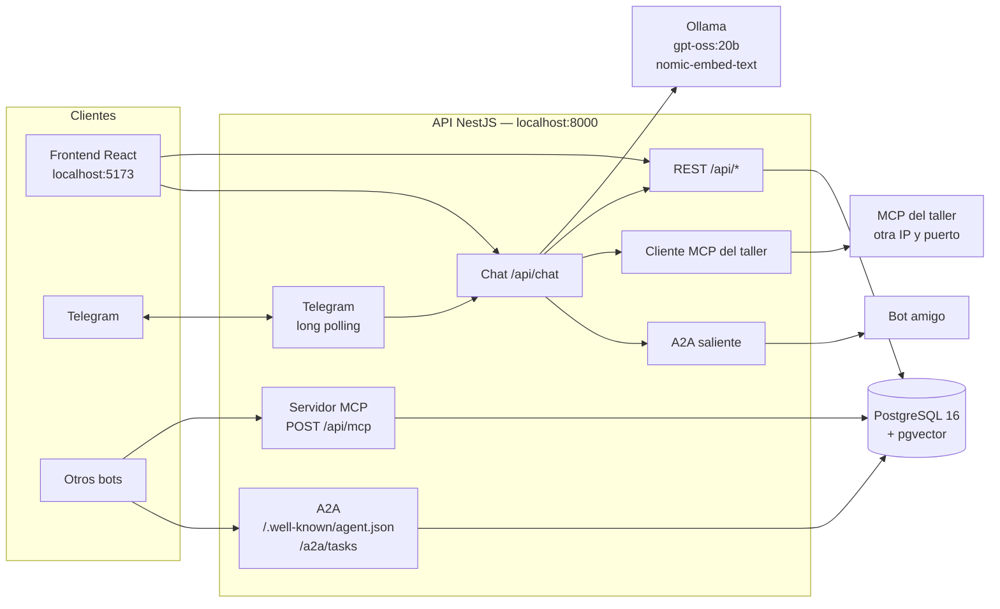
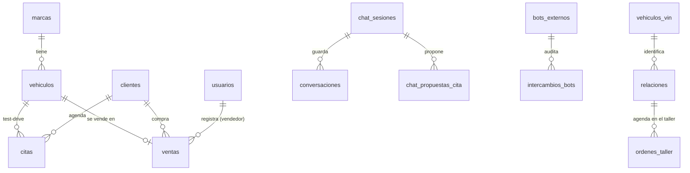
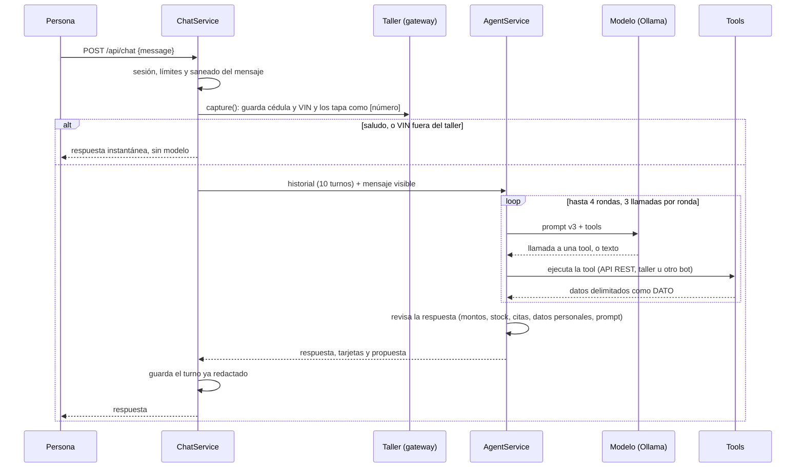

# AutoMax — Documentación técnica

Última actualización: 2026-10-31. Este documento explica **cómo está construido** AutoMax: arquitectura, módulos, datos,
API, chatbot y conexiones con otros sistemas. No repite lo que ya está en otros documentos; los enlaza:

| Si buscas… | Ve a |
|---|---|
| Levantar el proyecto desde cero, comandos y problemas frecuentes | [`README.md`](../README.md) |
| Qué debe hacer el producto (requisitos) | [`PRD.md`](PRD.md) |
| Por qué se decidió cada cosa (decisiones numeradas) | [`DECISIONES.md`](DECISIONES.md) |
| Avance por fases y pendientes | [`ESTADO.md`](ESTADO.md) |
| Guion para mostrar el proyecto | [`DEMO.md`](DEMO.md) |
| Correr el modelo de IA real y medirlo | [`GUIA-IA-COMPANEROS.md`](GUIA-IA-COMPANEROS.md), [`PLAN-FASE-4.md`](PLAN-FASE-4.md) |
| Reglas para quien programa (estilo, seguridad, flujo de trabajo) | [`CLAUDE.md`](../CLAUDE.md) |

---

## 1. Qué es AutoMax

Un concesionario de carros con:

- **Sitio web público:** catálogo con filtros, detalle con simulador de crédito, comparador y agenda de test-drive.
- **Panel interno** (admin y vendedor): citas, clientes, ventas, inventario, métricas y bots externos.
- **Asistente con IA local** (Ollama, `gpt-oss:20b`), en la web y en Telegram. Busca carros, compara, simula crédito, agenda
  test-drives y **agenda citas en el taller** consultando el MCP del taller.
- **Conexión con otros bots:**
  - Un **servidor MCP** de solo lectura (stock, precios y marcas).
  - **A2A** de entrada y de salida: tarjeta del bot y tareas.
  - Un **cliente MCP** para servicios externos (hoy, el taller).

## 2. Arquitectura



Principios que se repiten en todo el código:

- **El chatbot nunca toca la base de datos.** Sus tools llaman a la API REST pública, como lo haría el frontend. Las
  excepciones también pasan por un servicio y no tocan la base: la consulta a otro bot y las tools del taller.
- **Todo lo que llega de afuera es un dato, no una orden.** Esto vale para lo que responde otro bot, el taller o el
  modelo. Se valida con esquemas, se sanea, se recorta y nunca se ejecuta como instrucción.
- **Lo público y lo privado están separados.** El catálogo público usa campos explícitos (`PublicCatalogService`) y nunca
  expone entidades completas. Los datos personales van cifrados y no salen por MCP ni A2A.
- **Un módulo de Nest por dominio.** La lógica va en el `service` y el `controller` solo enruta.

## 3. Stack

| Capa | Tecnología |
|---|---|
| Backend | NestJS + TypeScript estricto + TypeORM |
| Base de datos | PostgreSQL 16 con pgvector (búsqueda semántica) |
| Frontend | React + Vite + TypeScript + Tailwind + shadcn/ui; React Query, React Router, framer-motion, recharts, lucide-react |
| Modelo de chat | Ollama local con `gpt-oss:20b` (API nativa `/api/chat` con Axios). También `groq` (externo) y `mock` (pruebas) |
| Embeddings | `nomic-embed-text` en Ollama (o `mock`) |
| MCP | `@modelcontextprotocol/sdk` + `zod` (servidor propio y cliente del taller) |
| Validación | `class-validator` + `class-transformer` con `ValidationPipe` global (`whitelist: true`) |
| HTTP | Axios (el cliente MCP usa el transporte del SDK oficial) |
| Pruebas | Vitest y Supertest (backend), Vitest (frontend), Playwright (navegador) |
| Infraestructura | Docker Compose: contenedores `automax-db` y `ollama` |

## 4. Estructura del repositorio

```
concesonario/
├── backend/
│   ├── src/                ← módulos de Nest (ver §5)
│   │   ├── database/       ← data-source, migraciones y seeds
│   │   └── common/         ← guards, filtros, paginación, throttling, cliente MCP genérico
│   └── test/               ← pruebas e2e con Supertest
├── frontend/
│   ├── src/features/       ← home, catalog, detail, compare, booking, chat, admin
│   ├── src/api/            ← cliente Axios y schema.d.ts (generado, nunca a mano)
│   └── public/autos/       ← fotos WebP de los 60 vehículos
├── chatbot/                ← solo herramientas de desarrollo
│   ├── bench/              ← medición del modelo
│   ├── eval/               ← evaluación de la búsqueda y de las 20 preguntas
│   └── a2a-demo/           ← bots de prueba amigo y malicioso
├── docs/
└── docker-compose.yml
```

## 5. Módulos del backend

| Módulo | Qué hace | Decisiones |
|---|---|---|
| `auth`, `usuarios` | Login con JWT, roles `admin` y `vendedor`, guard global (`@Public()` para lo abierto) | Fase 2 |
| `marcas`, `vehiculos` | Catálogo con filtros, orden, paginación, comparador (hasta 3) y búsqueda semántica (`GET /vehiculos/buscar`) | Fases 1 y 2 |
| `clientes`, `citas` | Clientes y test-drives de 60 min, de lunes a sábado de 8:00 a 18:00 (Bogotá). Los solapes los impide PostgreSQL con restricciones de exclusión | Fase 2 |
| `ventas` | Venta en una transacción con bloqueo de fila del vehículo | Fase 2 |
| `financiacion` | Simulador de crédito en centavos | Fase 2 |
| `metricas` | Resumen, ventas por mes y stock por marca para el panel | Fase 3 |
| `embeddings` | Vectores de cada vehículo, recálculo y `embeddings:sync` | Fase 4 |
| `chat` | Asistente: sesiones, agente con tools, proveedores de modelo, prompts versionados y revisiones de la respuesta | Fase 4; 79 a 94, 120, 124, 125 |
| `catalogo` | `PublicCatalogService`: catálogo público con campos explícitos, para MCP y A2A | Fase 5 |
| `mcp` | Servidor MCP de solo lectura: keys de bots, puerta de entrada, límites, auditoría y tools | Fase 5; 95 a 107 |
| `a2a` | Tarjeta del bot, tareas entrantes deterministas, cliente saliente con protección SSRF y panel | Fase 6; 108 a 122 |
| `telegram` | El mismo asistente por Telegram (long polling, solo chats privados) | 128 |
| `vin` | Registro de VIN sin datos del propietario, qué significa cada parte del VIN (con el dígito verificador) y ficha de la NHTSA para los VIN que no están registrados; `GET /vin/:vin` | 129, 132 |
| `relaciones` | Relación cliente–vehículo (`REL-####`): cédula, nombre y teléfono cifrados, HMAC de la cédula y garantía calculada | 130 |
| `taller` | Cliente del MCP del taller (real o simulado), gateway de las tools del agente y copia local de las órdenes | 130, 131 |

## 6. Modelo de datos

Las migraciones están en `backend/src/database/migrations/` (de `…000` a `…011`) y se aplican con
`npm run migration:run`. `synchronize` está siempre en `false`. El dinero se guarda como `numeric(12,2)` en pesos
colombianos (COP).



| Tabla | Para qué | Columnas principales |
|---|---|---|
| `marcas` | Las 10 marcas | nombre, pais, logo_url |
| `vehiculos` | Inventario (60 en la semilla) | marca_id, modelo, anio, version, precio, km, combustible, transmision, color, estado, imagenes, revision (control de ediciones simultáneas), embedding |
| `clientes` | Clientes del concesionario | nombre, telefono, correo, version |
| `citas` | Test-drives | cliente_id, vehiculo_id, fecha_hora, duracion_min, estado |
| `ventas` | Ventas | vehiculo_id, cliente_id, vendedor_id, precio_final, pago, fecha |
| `usuarios` | Personal (admin y vendedor) | nombre, correo, hash, rol |
| `chat_sesiones` | Sesión del chat (el token se guarda como hash) | token_hash, turnos, vehiculos_vistos, ultima_actividad |
| `conversaciones` | Historial del chat, ya redactado | sesion_id, rol, mensaje, version_prompt, modelo |
| `chat_propuestas_cita` | Test-drive propuesto por el bot que la persona confirma con un botón | sesion_id, vehiculo_id, inicia_en, vence_en, usada_en, cita_id |
| `bots_externos` | Bots amigos | nombre, url, clave_hash (HMAC), api_key_saliente (cifrada), límites, activo |
| `intercambios_bots` | Auditoría MCP y A2A (30 días, sin datos personales) | bot_id, direccion, canal, pregunta/respuesta recortadas, hashes, estado, duracion_ms |
| `vehiculos_vin` | Ficha de los VIN de prueba, sin propietario | vin, marca, modelo, anio, version, carroceria, puertas, motor, combustible, transmision |
| `relaciones` | Cliente–vehículo para el taller | id_relacion, vin, cedula_hmac, contacto_cifrado (AES-256-GCM), placa, kilometraje, fecha_venta, plan_garantia |
| `ordenes_taller` | Copia de las órdenes agendadas en el taller | codigo, id_relacion, sede_codigo, fecha_cita, estado, por_garantia, origen (`taller` o `simulado`) |

**Semillas** (`npm run seed`, idempotente con `upsert`):

- 10 marcas y 60 vehículos reales (6 por marca), con foto.
- Usuarios demo `admin` y `vendedor`, con la clave de `SEED_DEMO_PASSWORD`.
- 8 VIN y 8 relaciones de prueba (REL-1001 a REL-1008), con los datos que entregó el taller.

## 7. API REST

Prefijo `/api`. **`/.well-known/agent.json` y `/a2a/tasks` quedan fuera de ese prefijo.** El contrato completo, con
ejemplos, está en Swagger: `http://localhost:8000/api/docs`. El frontend genera sus tipos con `npm run api:types`.

| Ruta | Método | Acceso |
|---|---|---|
| `/auth/login` | POST | Público (5 por minuto) |
| `/auth/me` | GET | Con sesión |
| `/marcas`, `/marcas/:id` | GET | Público |
| `/marcas`, `/marcas/:id` | POST, PUT, DELETE | Admin |
| `/vehiculos`, `/vehiculos/:id`, `/vehiculos/comparar` | GET | Público |
| `/vehiculos/buscar` | GET | Público (búsqueda semántica, con límite) |
| `/vehiculos/:id/disponibilidad` | GET | Público (horas libres para test-drive) |
| `/vehiculos`, `/vehiculos/:id` | POST, PUT, DELETE | Admin |
| `/admin/vehiculos` | GET | Admin |
| `/clientes` | POST | Público (con límite) |
| `/clientes`, `/clientes/:id` | GET, PUT | Admin y vendedor |
| `/citas` | POST | Público (con límite) |
| `/citas`, `/citas/:id` | GET | Admin y vendedor |
| `/citas/:id/estado` | PATCH | Admin y vendedor |
| `/ventas` | POST | Admin y vendedor |
| `/ventas`, `/ventas/:id` | GET | Admin |
| `/financiacion/simular` | POST | Público |
| `/admin/metricas/resumen`, `/ventas-por-mes`, `/stock-por-marca` | GET | Admin |
| `/chat` | POST | Público (límites por IP y por sesión) |
| `/chat/sesion` | DELETE | Público (borra la sesión propia) |
| `/chat/estado` | GET | Público |
| `/chat/citas/confirmar` | POST | Público (la persona confirma el test-drive que propuso el bot) |
| `/vin/:vin` | GET | Público (ficha del VIN y qué significa cada parte, sin datos personales) |
| `/mcp` | POST | Bots con API key |
| `/admin/bots` | GET, POST | Admin |
| `/admin/bots/:id` | PATCH | Admin |
| `/admin/bots/:id/rotar-clave` | POST | Admin |
| `/admin/bots/:id/probar-conexion` | POST | Admin |
| `/admin/intercambios` | GET | Admin |
| `/.well-known/agent.json` | GET | Público |
| `/a2a/tasks` | POST | Bots con API key |

## 8. El chatbot

### 8.1 Un turno del chat



### 8.2 Tools del modelo

| Tool | Qué hace | Por dónde va |
|---|---|---|
| `buscar_vehiculos` | Busca por filtros o por texto libre (semántica) | API REST |
| `detalle_vehiculo` | Ficha de un vehículo | API REST |
| `comparar_vehiculos` | Hasta 3 lado a lado | API REST |
| `simular_credito` | Cuota mensual | API REST |
| `agendar_cita` | **Propone** un test-drive: la persona lo confirma con un botón (`/chat/citas/confirmar`) | API REST |
| `preguntar_a_otro_bot` | Pregunta a un bot amigo activo. Su respuesta va a una tarjeta «tercero no verificado» que el modelo **nunca ve** | `A2aOutboundService` |
| `identificar_cliente_taller` | Busca la relación con la cédula y el VIN que guardó el servidor (sin argumentos) | Gateway del taller |
| `prediagnosticar_taller` | Pide el prediagnóstico al taller | Gateway del taller |
| `listar_sedes_taller` | Sedes del taller | Gateway del taller |
| `consultar_horarios_taller` | Horas libres de una sede | Gateway del taller |
| `agendar_cita_taller` | Agenda en el taller | Gateway del taller |

`consultar_cita` está diferida: el bot solo confirma las citas de la sesión actual. Las tools del taller solo se le
ofrecen al modelo si está cargado `TallerModule`, y la del otro bot solo si hay bots activos.

### 8.3 Prompts

Los prompts están en `backend/src/chat/prompts/` y tienen versión (`v1`, `v2`, `v3`). Cada mensaje guardado registra
la versión y el modelo que lo respondió. Lo que agrega cada versión:

- **v2:** la regla 12, de la herramienta del otro bot.
- **v3:** la regla 13, el paso a paso del taller.

### 8.4 Lo que el código garantiza (no depende del modelo)

- **Montos:** todo precio de la respuesta debe venir de una tool del turno. Si no, se pide corrección y, si el modelo
  vuelve a fallar, se usa una plantilla armada con los datos.
- **Stock y citas:** no puede decir que hay un carro que no salió de las tools, ni que una cita «quedó agendada» si no lo
  confirmó la tool.
- **Datos personales:** las cédulas y los teléfonos se tapan en lo que ve el modelo y en el historial.
- **Prompt:** si el modelo intenta revelar sus instrucciones, se responde con una negativa fija.
- **Respuestas sin modelo:** los saludos y los mensajes con un VIN fuera del taller se responden al instante.

### 8.5 Proveedores

`CHAT_PROVIDER` elige el proveedor del modelo:

- `ollama` (por defecto): el modelo es `OLLAMA_MODEL` y `OLLAMA_THINK` controla el razonamiento de gpt-oss.
- `groq`: servicio externo, solo para evaluar.
- `mock`: un guion determinista para las pruebas.

## 9. Integración con el taller (Taller Pulgas Locas)

El asistente agenda citas en un taller externo consultando su servidor MCP, que está en otra IP y otro puerto. **El
modelo organiza los pasos con las tools**; el servidor valida cada paso.

### 9.1 Flujo

```mermaid
sequenceDiagram
  participant P as Cliente
  participant M as Modelo
  participant G as Gateway del taller (servidor)
  participant TM as MCP del taller

  P->>M: «Mi carro chilla al frenar, quiero llevarlo al taller»
  M-->>P: pide cédula y VIN
  P->>G: cédula + VIN (quedan en el servidor; el modelo ve [número])
  M->>G: identificar_cliente_taller
  G-->>M: vehículo, placa, garantía
  M->>G: prediagnosticar_taller(síntomas)
  G->>TM: prediagnosticar {id_relacion, mensajes_cliente}
  TM-->>G: especialidad, servicios con precio, garantía, sede sugerida
  G-->>M: prediagnóstico + sede recomendada
  M->>G: consultar_horarios_taller(sede)
  G->>TM: consultar_disponibilidad
  G-->>M: hasta 6 franjas libres
  M-->>P: prediagnóstico y horas
  P->>M: «la 5» … «sí»
  M->>G: agendar_cita_taller(sede, fecha_hora)
  G->>TM: agendar_cita {…, id_mensaje}
  TM-->>G: orden OT-####
  G-->>M: agendada
  M-->>P: orden, sede, fecha y siguiente paso
```

### 9.2 Reglas que pone el servidor

- **La cédula nunca llega al modelo.** Antes del modelo y del historial, los números de 6 a 10 dígitos se reemplazan por
  `[número]`. El estado del taller vive en memoria por sesión y vence a los 30 minutos.
- **Identificación:** con cédula y VIN, y se bloquea tras 3 intentos fallidos. La respuesta es la misma si falla la
  cédula o si falla el VIN.
- **Lo que se le manda al taller:** primero las palabras del cliente (sin cédula ni VIN), guardadas hasta el
  prediagnóstico, y después el resumen del modelo. Las reglas del taller entienden mejor lo que escribió el cliente.
- **El prediagnóstico siempre se muestra.** Si la respuesta del turno no trae ningún precio del prediagnóstico, el
  servidor antepone un resumen: especialidad, servicios con precio, garantía y sede.
- **Sede:** se usa la que sugiere el taller. Si no sugiere ninguna, una «revisión general» va a mantenimiento y una falla
  «especializada» va a la sede de esa especialidad.
- **Horarios:** salen solo del taller. Si el día pedido está cerrado o lleno, se buscan los días siguientes.
- **Agendar:** solo una hora que el taller ofreció en esa conversación, solo con un «sí» explícito en el último mensaje y
  solo una orden por conversación. El `id_mensaje` (`conc-<uuid>-agendar`) se repite en los reintentos para que el taller
  no duplique la orden. Si un reintento choca con la primera llamada («ya tiene la orden … abierta»), se consulta
  `listar_ordenes` para confirmarla.
- **Lo que responde el taller** se valida con zod, se sanea y se recorta. El teléfono de las sedes no se le pasa al modelo.

### 9.3 Configuración

| Variable | Valor |
|---|---|
| `TALLER_MCP_URL` | URL del MCP del taller. Vacía = **taller simulado** con las mismas sedes, precios y errores; las pruebas siempre usan el simulado. https obligatorio salvo en desarrollo (LAN) |
| `TALLER_MCP_TOKEN` | Token Bearer que entrega el taller. Va solo en `.env` |

Plazos: 15 s para sedes, horarios y órdenes; 60 s para `prediagnosticar` y `agendar_cita` (el taller responde en
unos 8 s). La IP del taller cambia con la red Wi-Fi: hay que actualizar `TALLER_MCP_URL` y reiniciar la API.

Base reutilizable para otros MCP externos: `backend/src/common/remote-mcp.client.ts`. Cada nuevo servicio tendrá su
`XXX_MCP_URL`, su `XXX_MCP_TOKEN` y sus propias tools.

### 9.4 Prueba real (31/10/2026)

La prueba se hizo por el chat, con `gpt-oss:20b` y el taller en `10.4.16.217:3417`:

| Caso | Prediagnóstico | Sede | Resultado |
|---|---|---|---|
| REL-1005, «chilla al frenar» | Frenos | PL-FRENOS | Orden **OT-0084**, 4/11/2026 a las 7:00 |
| REL-1001, «se prende la luz del motor y pierde fuerza» | Motor, $90.000 | PL-MOTOR | Horas reales del 2 y 3 de noviembre (sin agendar) |

### 9.5 Tienda de repuestos (preparada, sin conectar)

Para la garantía (decisión 135), AutoMax le pregunta a la tienda si para ese VIN se compró un repuesto del componente
que se reclama: si se compró, alguien lo cambió por fuera y la garantía no aplica. Las compras hechas para la misma
orden que se está validando no cuentan.

| Estado | Qué pasa con la garantía |
|---|---|
| Sin `REPUESTOS_MCP_URL` (hoy) | Se omite y cada línea válida termina con «(falta verificar con la tienda de repuestos: aún no está conectada)» |
| Conectada y responde | Si hay una compra del componente para ese VIN, la línea queda **no válida** |
| Configurada, pero no responde | La línea queda **no válida** («No se pudo verificar con la tienda de repuestos…») |

Por eso la URL solo se pone cuando la tienda responde: con una URL que no contesta, **todas** las garantías salen no
válidas.

Contrato: `consultar_compras_vin { vin, categoria }` → `{ compras: [{ fecha, codigo_repuesto, categoria, origen,
codigo_orden }] }`. Solo se envían el VIN y la especialidad (`frenos`, `suspension`, `motor`, `electrico`,
`transmision`), con un plazo de 8 s.

**Cómo conectarla.** Hoy la tienda está en otra red («APRENDIZ», `10.4.16.115:3100`):

1. Que este PC llegue al PC de la tienda. Hay dos opciones:
   - **Misma red:** los tres PC (AutoMax, taller y tienda) en la misma Wi-Fi. La IP de la tienda cambia con la red, así
     que hay que pedírsela de nuevo (`ipconfig`). En el PC de la tienda, el firewall debe dejar entrar el puerto 3100 con
     el perfil de red **privada**.
   - **Túnel**, si no pueden estar en la misma red: en el PC de la tienda, `cloudflared tunnel --url
     http://localhost:3100` da una dirección `https://….trycloudflare.com`, y la URL queda
     `https://….trycloudflare.com/mcp`. Si su MCP filtra la cabecera `Host`, deben permitir ese nombre. La dirección
     cambia cada vez que se reinicia el túnel.
2. Probarla antes de activarla, sin tocar el `.env` (PowerShell, desde `backend/`):

   ```powershell
   $env:REPUESTOS_MCP_URL='http://<ip-de-la-tienda>:3100/mcp'; $env:REPUESTOS_MCP_TOKEN='<token de la tienda>'; npm run tienda:probar
   ```

   El comando hace tres pruebas: salud (`/api/salud`), REL-1006 `suspension` (debe traer una compra) y REL-1006
   `frenos` (no debe traer ninguna). No muestra el token. Si termina con «Todo bien», se sigue al paso 3; si no, la
   tienda se deja sin conectar. Después de la prueba, se borran las dos variables:
   `Remove-Item Env:REPUESTOS_MCP_URL, Env:REPUESTOS_MCP_TOKEN`.
3. Agregar al `.env` **las dos líneas juntas**: `REPUESTOS_MCP_URL` y `REPUESTOS_MCP_TOKEN`. El token debe tener al menos
   16 caracteres. Una URL sin token no deja arrancar la API.
4. Reiniciar la API. El log ya no dice «Sin REPUESTOS_MCP_URL».
5. Pedirle al taller dos `validar_garantia` de REL-1006:
   - `suspension` debe salir **no válida** por la compra en la tienda, siempre que el taller no tenga registrada
     también una intervención.
   - `frenos` debe salir **válida** y ya sin la nota de la tienda pendiente.

## 10. Servidor MCP (otros bots consultan a AutoMax)

- **Ruta:** `POST /api/mcp`, JSON-RPC sin estado (Streamable HTTP).
- **Tools de solo lectura:** `consultar_stock`, `consultar_precio` y `listar_marcas`. Todas salen del catálogo público.
  **`agendar_cita` no se expone**, porque un bot no puede dar la confirmación humana que exige una cita (decisión 97).
- **API keys:** cada bot tiene la suya.
  - Se muestra una sola vez y se guarda como HMAC con pepper.
  - Se puede rotar, y el bot se puede desactivar.
- **Puerta de entrada (compartida con A2A):**
  - Cualquier fallo de autenticación devuelve el mismo 401.
  - Hay límite por minuto y cuota diaria por bot.
  - 10 fallos de autenticación en 5 minutos bloquean esa IP durante 15 minutos (depende de `trust proxy`, pendiente antes de desplegar).
- **Herramientas del taller (decisión 134):** un bot con el permiso `taller` ve además `consultar_relacion`, `decodificar_vin`, `validar_garantia` y `notificar_estado_vehiculo`, que llevan datos de clientes. Un bot sin ese permiso no las ve ni las puede llamar. `validar_garantia` decide con reglas fijas y le responde al taller con su `registrar_resultado_garantia`.
- **Auditoría:** en `intercambios_bots`, con texto recortado y hashes, sin datos personales, durante 30 días.

## 11. A2A (conversación entre bots)

- **Tarjeta:** `GET /.well-known/agent.json` es público y su `url` sale de `A2A_PUBLIC_BASE_URL`, nunca de la cabecera
  `Host`.
- **Entrante:** `POST /a2a/tasks` con `Authorization: Bearer amx_…`. Es **determinista**:
  - Responde solo desde el catálogo público y el simulador de financiación, sin modelo ni embeddings.
  - `citas` es solo informativa.
  - La identidad del bot sale de la key; el campo `from` es solo informativo.
- **Saliente:** la tool `preguntar_a_otro_bot` solo acepta bots activos registrados y manda solo la pregunta, nunca el
  historial. La conexión tiene:
  - protección SSRF, sin redirecciones ni proxy;
  - tope de bytes y de tiempo;
  - circuit breaker y límites por bot.
  - En desarrollo, la LAN se habilita solo con `A2A_DEV_ALLOWED_TARGETS` (IP:puerto exactos). La API no arranca con esa
    variable en producción.
- **Respuesta del otro bot:** se trata como dato no confiable. Se sanea (texto plano, sin enlaces, hasta 600
  caracteres) y se muestra en una tarjeta aparte.
- **Bots de prueba:** en `chatbot/a2a-demo/` hay uno amigo y uno malicioso, solo para desarrollo.

## 12. Telegram

Si `TELEGRAM_BOT_TOKEN` tiene valor, la API atiende el mismo asistente por Telegram:

- Usa long polling con Axios, así que no hace falta una URL pública.
- Solo responde en chats privados.
- Las citas también piden confirmación humana.

Con la variable vacía, Telegram queda apagado (decisión 128).

## 13. Frontend

| Pantalla | Ruta |
|---|---|
| Portada: auto destacado, carrusel de marcas y destacados | `/` |
| Catálogo con filtros laterales y paginación | `/catalogo` |
| Detalle: galería, ficha, simulador de crédito y test-drive | `/catalogo/:id` |
| Comparador (hasta 3) | `/comparar` |
| Chat flotante (indicador «escribiendo…», tarjetas de vehículos, propuesta de cita, tarjeta de tercero) | En todas las páginas públicas |
| Panel: login | `/admin/login` |
| Panel: citas y clientes | `/admin/citas`, `/admin/clientes` |
| Panel: ventas | `/admin/ventas`, `/admin/ventas/nueva`, `/admin/ventas/:id` |
| Panel solo admin: métricas, inventario y bots | `/admin/metricas`, `/admin/inventario`, `/admin/bots` |

Detalles de implementación:

- **Código por funcionalidad:** cada pantalla está en `frontend/src/features/<funcionalidad>/`.
- **Datos:** se piden con React Query y Axios.
- **Paleta:** variables CSS (negro `#0A0A0A` y acento rojo `#DC2626`).
- **Tema:** oscuro por defecto; el modo claro está pendiente.
- **Imágenes:** WebP con `loading="lazy"`.

## 14. Seguridad

| Tema | Cómo se resuelve |
|---|---|
| Secretos | Solo en `.env`, que no está en git; `.env.example` es la plantilla. La API no arranca sin `MCP_KEY_PEPPER` y `BOT_KEY_ENCRYPTION_KEY` |
| Autenticación | JWT (1 h) y roles verificados en el backend con guards. Todo es privado salvo lo marcado `@Public()` |
| Entrada | DTOs con `class-validator` y `whitelist: true`. Lo externo se valida con zod |
| Límites | Rate limit global y por ruta: login, chat (por IP y por sesión), formularios públicos, MCP y A2A |
| Datos personales | Cédula, nombre y teléfono cifrados con AES-256-GCM y la cédula buscable solo por HMAC. No salen por MCP ni A2A, y se tapan en el chat |
| Prompt injection | Lo que viene de otro bot o del taller es dato: se delimita, se sanea y se recorta. El texto del otro bot nunca llega al modelo |
| SSRF | El A2A saliente bloquea IP privadas, redirecciones y proxies. Las URL de MCP salen solo de la configuración, nunca de un mensaje |
| CORS | Restringido a `FRONTEND_URL` |

## 15. Configuración (`.env`)

El detalle y los valores de ejemplo están en `.env.example`. Por grupos:

| Grupo | Variables |
|---|---|
| Base de datos | `DB_HOST`, `DB_PORT`, `DB_USER`, `DB_PASSWORD`, `DB_NAME` |
| API | `PORT`, `JWT_SECRET`, `JWT_EXPIRES_IN`, `THROTTLE_LIMIT`, `FRONTEND_URL`, `FINANCING_DEFAULT_RATE_EA` |
| Modelo de chat | `CHAT_PROVIDER`, `OLLAMA_HOST`, `OLLAMA_MODEL`, `OLLAMA_NUM_CTX`, `OLLAMA_KEEP_ALIVE`, `OLLAMA_THINK`, `OLLAMA_TIMEOUT_MS`, `CHAT_TURN_TIMEOUT_MS`, `GROQ_API_KEY`, `GROQ_MODEL` |
| Búsqueda semántica | `EMBEDDING_PROVIDER`, `OLLAMA_EMBED_MODEL`, `OLLAMA_EMBED_PREFIXES`, `SEARCH_MIN_SIMILARITY` |
| Semillas | `SEED_DEMO_PASSWORD` |
| MCP y A2A | `MCP_KEY_PEPPER`, `BOT_KEY_ENCRYPTION_KEY`, `MCP_KEY_PEPPER_VERSION`, `MCP_KEY_PEPPER_PREVIOUS`, `A2A_PUBLIC_BASE_URL`, `A2A_DEV_ALLOWED_TARGETS`, `MCP_ALLOWED_HOSTS` |
| Telegram | `TELEGRAM_BOT_TOKEN` |
| Taller | `TALLER_MCP_URL`, `TALLER_MCP_TOKEN` |
| Tienda de repuestos | `REPUESTOS_MCP_URL`, `REPUESTOS_MCP_TOKEN` (vacías = sin conexión; ver 9.5) |
| VIN | `VIN_DECODER_EXTERNAL` (ficha de la NHTSA; `false` = solo la lectura local) |
| Solo evaluación | `CHAT_EVAL_MODE`, `CHAT_LIMIT_PER_MINUTE`, `CHAT_LIMIT_PER_HOUR` (se ignoran en producción) |

## 16. Pruebas

| Suite | Comando | Qué cubre |
|---|---|---|
| Unitarias del backend | `cd backend && npm run test` | Servicios, agente, tools, revisiones de la respuesta, MCP, A2A y taller (864 pruebas al 31/10/2026) |
| e2e del backend | `cd backend && npm run test:e2e` | La API completa con Supertest sobre una base de pruebas, con el modelo y el taller simulados |
| Frontend | `cd frontend && npm run test` | Componentes y pantallas con Vitest |
| Navegador | Playwright (ver «Smoke de navegador» en el README) | Tres flujos de punta a punta |
| Calidad del modelo | `chatbot/eval/` | Las 20 preguntas con el modelo real (`GUIA-IA-COMPANEROS.md`) |

Las pruebas nunca usan el `.env` para sacar valores: usan bases y variables temporales.

## 17. Operación

```bash
docker compose up -d                       # base de datos (automax-db) y Ollama
cd backend && npm run migration:run        # aplica migraciones
cd backend && npm run seed                 # marcas, vehículos, usuarios demo, VIN y relaciones
cd backend && npm run start:dev            # API en http://localhost:8000/api
cd frontend && npm run dev                 # web en http://localhost:5173
cd frontend && npm run api:types           # regenera los tipos de la API (con la API encendida)
cd backend && npm run tienda:probar       # prueba la tienda de repuestos antes de activarla (ver 9.5)
docker exec ollama ollama pull gpt-oss:20b # modelo del chat
```

Al cambiar código del backend, hay que reiniciar la API. `start:dev` lo hace solo.

## 18. Pendientes

La lista viva está en [`ESTADO.md`](ESTADO.md) y en la sección «Pendientes» de [`DECISIONES.md`](DECISIONES.md). Los
pendientes de la integración con el taller:

- Conectar la tienda de repuestos cuando este PC la alcance (misma red o túnel): pasos en la sección 9.5.
- Seguimiento de la orden después de agendar, y cancelarla desde el chat.
- Llevar `TALLER_MCP_URL` de una IP de LAN a una dirección fija con https antes de producción.
